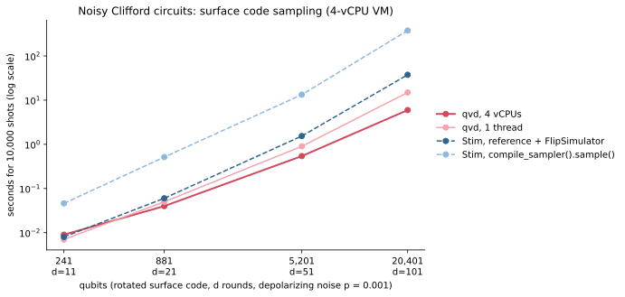
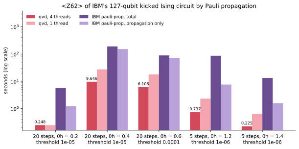

# Benchmarks

Recorded results, the scripts that produced them, and the charts drawn from
them. Every comparison runs the same OpenQASM file, written by qvd, through
each simulator.

```
benchmarks/
├── results/
│   ├── machine.json            hardware, versions, measurement notes
│   ├── statevector.csv         dense simulation: qvd vs qsim vs Qiskit Aer
│   ├── stabilizer.csv          Clifford circuits: qvd vs Stim vs Qiskit Aer
│   ├── noise.csv               noisy (and noiseless) surface codes: qvd vs Stim
│   ├── noise_agreement.csv     detection rates of noisy codes: qvd vs Stim
│   ├── mps.csv                 matrix product states: qvd vs Qiskit Aer vs quimb
│   ├── nearclifford.csv        Clifford+T circuits: qvd vs Qiskit Aer
│   ├── pauliprop.csv           expectation values: qvd vs IBM's pauli-prop
│   └── stabilizer_steps.csv    how each optimisation changed the d=101 time
├── charts/                     SVGs drawn from results/ by plot.py
├── compare.py                  times Qiskit Aer and qsim on a QASM file
├── compare_stim.py             times Stim and Qiskit Aer's stabilizer method
├── bench_noise.py              noisy surface codes against Stim -> noise*.csv
├── compare_mps.py              times Qiskit Aer's and quimb's MPS simulators
├── compare_nearclifford.py     times Qiskit Aer's methods on Clifford+T circuits
├── compare_pauliprop.py        times IBM's pauli-prop on an expectation value
├── bench_pauliprop.py          runs qvd and pauli-prop on every case -> pauliprop.csv
└── plot.py                     results/*.csv -> charts/*.svg
```

The CSV files are in long format (one row per simulator and case), with
times in seconds, so they can be loaded directly by other tools or pages.

## Machine

Intel Core i9-14900K (8 P-cores with hyper-threading + 16 E-cores, 32
threads, AVX2 + FMA, no AVX-512), 62 GB DDR5, Linux 7.0, Rust 1.96. Python
packages: qiskit 2.5.2, qiskit-aer 0.17.2, qsimcirq 0.22.1, cirq-core 1.7.0,
stim 1.16.0, quimb 1.15.0. Measured on 2026-10-09.

## State-vector simulation


Random circuits are depth-20 Google-style circuits (√X, √Y, √W on every
qubit and CZ on a brick pattern); QFT is the quantum Fourier transform.
Each simulator gets its best of 16 or 32 threads. qvd's times include
allocating the state; the others include sampling one shot, and qsim's
include converting the circuit in Python. qsim's CPU backend is single
precision only. Amplitudes agree with Qiskit Aer to 7×10⁻¹³ in double
precision.

## Clifford circuits


Rotated surface-code memory experiments, d rounds, 10,000 shots. qvd ran
on a pool of 8 P-cores and on one thread; Stim is single-threaded. Stim is
timed two ways:
- `reference_sample()` plus a `FlipSimulator`, whose results are
  measurement-major like qvd's (the fair comparison);
- `compile_sampler().sample(bit_packed=True)`, which returns shot-major
  arrays and is much slower at these sizes.

Qiskit Aer's stabilizer method was not run past d = 21 (it took 636 s
there). A virtual machine shared the machine: Stim, Aer and qvd on one
thread ran while it used about six cores, and qvd on 8 P-cores was
re-measured after the parallel reference shot while it used about 14. So
absolute times are a little high, and pessimistic for qvd's 8-core column.


The steps that took the distance-101 code (20,401 qubits, 101 rounds) from
37 s to 1.5 s. Steps 1–7 were measured on a quiet machine. Step 8 was
measured under the heavier load; under that same load the build before it
took 2.57 s. [docs/DESIGN.md](../docs/DESIGN.md)
explains each one.

Stim's times here come from circuits with one instruction per line, as
`compare_stim.py` wrote them then; that slows Stim by 1.7× at d = 21 and
1.07× at d = 51 (measured on the 4-vCPU VM below). The script now groups
consecutive instructions, and the next section has the fair comparison.

## Noisy Clifford circuits



The surface codes above with uniform circuit-level depolarizing noise,
p = 0.001 (`library::with_depolarizing_noise`), and without it (p = 0 rows
in `noise.csv`), 10,000 shots. Measured on the 4-vCPU Xeon virtual machine
(`pauliprop_machine` in `machine.json`), not the i9. Both simulators read
the same Stim file written by the `stabilizer` example (`--stim`), with one
instruction per layer and channel as in Stim's generated circuits. qvd ran
on 4 threads and on 1 (best of 3); Stim on one thread, best of 3 (one run
at d = 101). `noise_agreement.csv` compares the fraction of shots in which
each detector fires (XOR of consecutive measurements of one ancilla),
qvd through the Python package against Stim's sampler, 200,000 shots each,
with a two-sample z-score per detector.

## Stim circuits and detection events

Stim's own generated circuits (`surface_code:rotated_memory_z`, d rounds,
all four noise parameters at p = 0.001), read by qvd's Stim reader, against
Stim's detector sampler, 10,000 shots (`detectors.csv`). Measured on a
4-vCPU Xeon virtual machine (`detectors_machine` in `machine.json`). Both
run in one Python process and return shot-major NumPy bool arrays; qvd on
4 threads and on 1, its time including reading the text; Stim on one
thread, with and without `bit_packed=True`; best of 3. Distance 101 is
left out: a shot-major result of a million detectors × 10,000 shots is
10 GB in either simulator. `detectors_agreement.csv` compares detection
rates (200,000 shots, a two-sample z-score per detector) and the logical
error rates after the same PyMatching decoder; `detectors_long.csv` repeats
the smallest code with 24 million shots per simulator, per detector.

## Matrix product states


1000 shots, χ capped as labelled and the smallest singular values dropped
while their squares sum below 10⁻¹⁶, in all three simulators. qvd ran on 8
P-cores (best of three), Qiskit Aer with 8 threads, quimb's
`CircuitPermMPS` with 8 BLAS threads after a warm-up. Aer reports only a
total; `mps.csv` has gate and sampling times for the other two, and the
fidelity estimates. A busy virtual machine shared the machine during these
runs, for all three alike.

## Clifford+T circuits


Random Clifford+T circuits from `library::random_clifford_t` (layers of
random one-qubit Cliffords and CX on random pairs, T gates on random
qubits), 1000 shots, 8 threads. qvd's near-Clifford time is the best of
three; every Aer method ran in its own process, stopped at 600 s. Aer's
`extended_stabilizer` is approximate and rejects circuits over 63 qubits;
there is no state vector past 30 qubits. A virtual machine shared the
machine during these runs.

## Expectation values (Pauli propagation)



`<Z62>` of IBM's 127-qubit kicked Ising circuit (`library::kicked_ising`
on `library::eagle_heavy_hex`), the same coefficient threshold in both.
Measured on a different machine from the rest of this page: a cloud
virtual machine with 4 vCPUs of an Intel Xeon at 2.80 GHz and 15 GB
(`pauliprop_machine` in `machine.json`). qvd ran on 4 threads and on 1
(best of 3); pauli-prop 0.2.1 ran once per case in its own process, on
one thread (its CPU time matched its wall time), with `max_terms` well
above what each case needs so that only the threshold truncates. Its
"propagation only" time is its Rust propagation through the rotations;
its total adds moving the Cliffords out in Python and evolving the final
strings through them in Qiskit. Both return the same value, the same
number of strings and the same dropped one-norm in every case.

## Reproducing

```sh
python3 -m venv .bench-venv
.bench-venv/bin/pip install qiskit qiskit-aer qsimcirq cirq-core ply stim matplotlib quimb

# State vector: qvd's time is printed; the QASM file feeds the others.
cargo run --release --example bench -- random 28 20 f32 4 14 --qasm /tmp/c.qasm
.bench-venv/bin/python benchmarks/compare.py /tmp/c.qasm --precision single --threads 32

# Clifford: surface code of distance 51, 51 rounds, 10,000 shots.
cargo run --release --example stabilizer -- surface 51 51 10000 --qasm /tmp/s.qasm
.bench-venv/bin/python benchmarks/compare_stim.py /tmp/s.qasm --shots 10000

# Noisy surface codes against Stim (and the Python package, for agreement).
cargo build --release --example stabilizer
(cd python && maturin develop --release)
.bench-venv/bin/python benchmarks/bench_noise.py

# Detection events of Stim's generated circuits against Stim
# (pip install pymatching; the Python package built as above).
.bench-venv/bin/python benchmarks/bench_detectors.py --distances 11,21,51
.bench-venv/bin/python benchmarks/bench_detectors.py --long

# MPS: 64 qubits, depth 20, χ ≤ 256, 1000 shots.
cargo run --release --example mps -- random 64 20 256 1000 --qasm /tmp/m.qasm
.bench-venv/bin/python benchmarks/compare_mps.py /tmp/m.qasm --max-bond 256 --shots 1000

# Clifford+T: 100 qubits, depth 30, 24 T gates, 1000 shots.
cargo run --release --example nearclifford -- 100 30 24 1000 --qasm /tmp/n.qasm
.bench-venv/bin/python benchmarks/compare_nearclifford.py /tmp/n.qasm --shots 1000 \
    --methods matrix_product_state,extended_stabilizer

# Pauli propagation: every case, qvd and pauli-prop (pip install pauli-prop).
cargo build --release --example pauliprop
.bench-venv/bin/python benchmarks/bench_pauliprop.py

# After editing results/*.csv:
.bench-venv/bin/python benchmarks/plot.py
```

`bench` takes the circuit (`random`, `qft`, `ghz`), qubits, depth, precision
(`f32`, `f64`), maximum fused qubits and region bits (0 turns cache blocking
off); `QVD_PLACEMENT=pcores|pthreads|allcores|all` selects the threads. The
`stabilizer` example takes `surface <distance> <rounds> <shots>` or
`random <qubits> <depth> <shots>`, with `--noise P` for depolarizing noise
and `--stim FILE` to write the circuit in Stim's format, or
`detectors <Stim file> <shots>` to time reading a Stim file, sampling its
detectors and making them shot-major;
`QVD_THREADS=pcores|all|<n>` selects the threads (P-cores by default). The `mps` example takes
`<random|grid|qft|ghz> <qubits | ROWSxCOLS> <depth> <max bond> [shots]`, and
the `nearclifford` example `<qubits> <depth> <T count> [shots] [--backend nc|sv|mps]`,
and the `pauliprop` example `<steps> <θ_h> <observable> [threshold] [max terms]`
(`QVD_THREADS=<n>` sets its threads).
